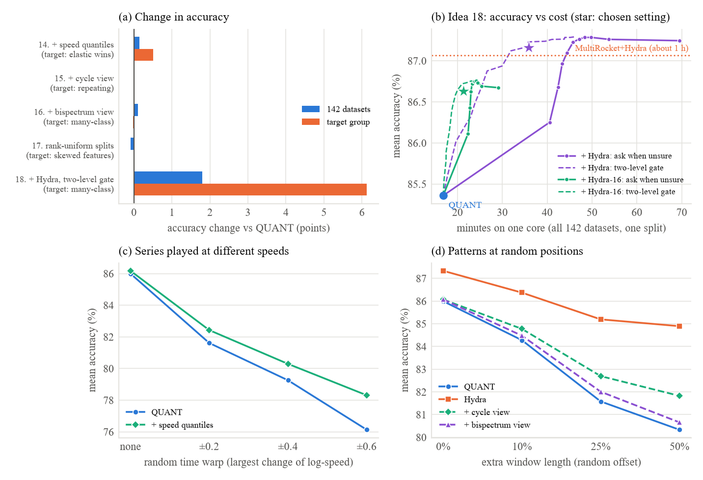

# Improving QUANT: what we tried and what happened

*Status, 10 October 2026: all experiments are complete: round 1 (five ideas) and round 2 (five "efficient approaches", ideas 14–18), with their stress tests and one-core timings. The two choices we made after seeing results were also checked on data they had not seen: idea 18's two-level gate (it held up) and idea 10's "padded + native" version (its gain mostly did not carry over).*

## The short version

We tried five ways to make QUANT more accurate. One clearly worked:

- **Combining QUANT with Hydra** (a second, very different method) raised average accuracy from **85.4% to 87.4%** over 142 datasets. That puts it level with HIVE-COTE 2, the most accurate method in the big 2024 comparison, which takes weeks.
- **The price:** on one CPU core, QUANT needs 16 minutes for all 142 datasets, and the combination needs **66 minutes** (simple average) to **91 minutes** (weighted average). That is **4–6× longer**. It is about what MultiRocket+Hydra costs, and that method is almost as accurate.
  - *Correction (found in round 2):* as we ran it, the simple average still needed part of the cross-validation, which made it ×5.0 rather than ×4.2. Round 2 replaces that cross-validation with a free calibration, at the same accuracy: ×4.1.

The other ideas:

- **Ideas 1 and 2** (new position-free features) helped a little: +0.4 points each.
- **Idea 10** (no padding) helped only in its second version, which keeps the padded view *and* adds the unpadded one: +2.0 points on the 11 variable-length datasets. We designed that version after seeing the first results, so we checked it on three variable-length datasets we had never used: there it gave only +0.2 points (clear on one of the three). The big gain seems specific to gesture data.
- **Idea 5** (augmentation) did not help on average.

When patterns were moved to random positions, every idea we stress-tested (1, 2, 3 and 5) made QUANT more robust. The ensemble lost no more accuracy than Hydra, which ignores position entirely.

The main lesson is that QUANT's reliance on *where* things happen in a series is a weakness on some datasets and a strength on others. What works is *adding* a position-free view next to QUANT's own; replacing it does not work.

**Round 2:** five cheap ideas (14–18).
- **Idea 18 is the clear winner:** ask Hydra only about the test series QUANT is unsure of. That gives **87.16% (+1.8 points) at 2.1× QUANT's time**, 95% of the ensemble's gain at half its cost, and statistically level with MultiRocket+Hydra.
  - With a smaller Hydra: +1.3 points for only 1.3× QUANT's time.
- **Idea 14** (speed-invariant quantiles) gave a small but significant gain: +0.14 points overall, and +0.5 where elastic methods beat QUANT.
- **Ideas 15, 16 and 17** did not help on average, although the cycle view (15) made QUANT more robust to moved patterns.

## Some words used below

- **Accuracy**: the share of test series a method labels correctly. "+1 point" means +1 percentage point, e.g. 85.4% → 86.4%.
- **Dataset**: one classification problem from the UCR archive, e.g. telling apart gestures, heartbeats or kinds of beef from their measured curves. We use the 142 datasets of the QUANT paper.
- **Resample**: one random split of a dataset into training and test data. The archive provides 30 fixed splits, so everyone tests on exactly the same splits.
- **W/D/L (wins/draws/losses)**: on how many datasets the new version beat, tied or lost to plain QUANT.
- **p-value (Wilcoxon signed-rank test)**: how likely a difference this consistent would be if the change really did nothing. Below 0.05 we call it a real effect, not luck.

## What the experiments were based on

1. **Our reproduction of QUANT.** We re-ran the paper's full experiment and got 85.51% vs the paper's 85.68%. The small gap comes from 4 datasets that were corrected after the paper was published. Plain QUANT's numbers below come from this run.
2. **Our weakness tests** (paper Section IV). These found where QUANT loses accuracy:
   - **When the same pattern appears at different times**, QUANT suffers. QUANT summarises fixed time windows (first half, second quarter, ...), so a pattern that moves lands in a different window. With patterns at random positions it lost 5.6 points, against 2.4 for Hydra.
   - **With many classes and few examples per class** it does badly: 5.6 points behind Hydra on 18 such datasets, and up to 27 points behind on the "Pig" heartbeat datasets.
   - **On variable-length series padded to equal length** (11 datasets), padding costs about 8 points on the most padded series.
3. **The ideas list** (`ideas.md`). We took the five highest-ranked ideas that run on a laptop CPU. Idea 4 (a pre-trained "TabPFN" classifier) was skipped because it needs a GPU.

**The test rules**, the same for every idea:

- **QUANT stays the same.** Its code is never changed. Each idea *adds* something: more features, extra training copies, or a second model. The classifier is always QUANT's own (a forest of 200 random trees, same settings).
- **Same data as the reproduction.** All 142 datasets use the same official splits and the same random seeds, so any difference comes from the idea itself. A built-in check confirms that plain QUANT gives exactly the reproduction's numbers in the new code.
- **10 splits per dataset instead of 30**, to fit the laptop (Ryzen 5 5600H, no GPU). The 11 variable-length datasets are small, so they got all 30. On the first 10 splits, plain QUANT scores **85.36%**, and that is the number to beat.
- **Code and output.** The code is `scripts/improvement_tests.py`, with the new features in `scripts/quant_extensions.py`. The numbers are produced by `scripts/improvement_analysis.py` and saved in `results/improvements/summary.txt`.

## The five ideas and their results

All accuracies are averages over 142 datasets × 10 splits unless noted. Plain QUANT scores 85.36%.

| Idea | What it adds | Accuracy | Change | W/D/L | p | Runtime vs QUANT** | Verdict |
|---|---|---|---|---|---|---|---|
| 3. QUANT + Hydra ensemble | a second method; average their votes | **87.39%** | **+2.03** | 99/10/33 | 4e-12 | **×5.8** (×4.1 with equal weights and round 2's free calibration) | **Success** |
| 1. Position-free quantiles | "is this pattern *anywhere*?" features | 85.75% | +0.39 | 84/19/39 | 2e-6 | ×1.4 | Success (small) |
| 2. Quantiles of convolutions | small-shape detectors, summarised by quantiles | 85.76% | +0.40 | 78/7/57 | 0.004 | ×4.0 | Success (small) |
| 10. Variable-length QUANT: padded + native | keep the padded view, add windows that scale with each series | 77.53% vs 75.55%* | +1.97 | 10/0/1 | 0.005 | ×9† (our slow code; training ×1.9) | Success on these 11 |
| 10, fresh-data check | the same version, unchanged, on 3 variable-length datasets never used before | 92.52% vs 92.31%‡ | +0.21 | 2/0/1 | too few datasets | | Small gain (clear on 1 of 3) |
| 10a. ... native windows + length | replace padding with windows that scale with each series, plus the series length (without the length: 75.35%, −0.20, p = 0.97) | 75.66% vs 75.55%* | +0.11 | 5/0/6 | 0.9 | ×8† | Did not help |
| 5. Shift/stretch augmentation | shifted and stretched training copies | 84.64% | −0.72 | 46/9/87 | 7e-5 | ×5.8† | Did not help |
| 5b. ... + test-time averaging | the same, plus averaging over shifted test copies | 85.01% | −0.35 | 59/10/73 | 0.03 | ×5.9† | Did not help (but +1.1 on many-class data) |

\* Only the 11 variable-length datasets, with 30 splits.
‡ Only the three Asphalt datasets, with 30 splits (see idea 10 below).
\*\* Total time to compute the features, train and predict once on every dataset, on one CPU core, the way the QUANT paper reports its 15 minutes. Plain QUANT takes 15.7 minutes this way.
† Measured with all 12 threads instead (plain QUANT: 5.2 minutes), because these versions were not part of the one-core timing run.

### Idea 3: QUANT + Hydra ensemble. Success.

- **What we did:** trained QUANT and Hydra separately and averaged their predicted class probabilities. Hydra is a convolution method that counts which small shapes occur *anywhere* in a series.
  - Hydra's raw scores were first turned into probabilities, calibrated on the training data.
  - Each method's vote was weighted by how accurate it was in a cross-validation on the training data. This is the "CAWPE" rule from HIVE-COTE.
- **Why:** the two methods fail on different data. QUANT is good when *where* and *how high* the values are matters; Hydra is good when shapes move around.
- **Result:** 87.39%, **+2.0 points**, better on 99 datasets and worse on 33.
  - On the 18 many-class datasets: +6.4 points, e.g. PigCVP +27, PigAirwayPressure +26.
  - It beats picking the better of the two methods per dataset (87.29%), because combining helps even where both are decent.
  - Equal weights gave almost the same: 87.25%. (*Correction:* this version still used the cross-validation to calibrate Hydra's scores; see "A correction to idea 3" in round 2. Calibrated for free instead, it also gives 87.25%.)
- **Cost: 4–6× slower than QUANT.** Compute time for one train/test run of all 142 datasets on one CPU core, measured the way the QUANT paper reports its 15 minutes:

  | | Minutes | vs QUANT | Accuracy |
  |---|---|---|---|
  | QUANT alone | 15.7 | ×1 | 85.36% |
  | QUANT + Hydra, equal weights* | 65.6 | ×4.2 | 87.25% |
  | QUANT + Hydra, weighted | 91.3 | ×5.8 | 87.39% |

  \*Without the cross-validation that calibrated Hydra's scores, which this version still used. That took 15.1 min more in the round-2 timing run, making it ×5.0. With round 2's free calibration it costs ×4.1 (69.5 min against QUANT's 16.8 min in that run), at the same accuracy.

  - **Where the time goes** (weighted version, 91 min):
    - computing Hydra's features: 46 min, half of the total;
    - the extra cross-validation that sets the weights: 26 min;
    - QUANT itself: 16 min;
    - training Hydra's classifier: 4 min.
  - **The weighting is poor value.** It costs 26 extra minutes for +0.14 points, so the equal-weights version is the better deal.
  - **On all 12 threads** of the laptop, the same run takes 5.2 min (QUANT), 24.9 min (equal weights) and 34.1 min (weighted).
  - **In context:** the QUANT paper reports about 1 h 15 min for MultiRocket+Hydra and several weeks for HIVE-COTE 2. So the ensemble reaches HIVE-COTE 2's accuracy at roughly MultiRocket+Hydra's cost. It is *not* cheaper than MultiRocket+Hydra, which is about as accurate.

### Idea 1: position-free pooled quantiles. Small success.

- **What we did:** slid windows of several sizes over the whole series and took quantiles in each. We then kept only the highest, lowest and average value of each quantile over all positions. These features say "somewhere there is a stretch like this", no matter where. QUANT's normal features were kept.
- **Result:** +0.4 points, better on 84 datasets and worse on 39. This is a small effect, but very unlikely to be luck (p = 0.000002).
  - The gain is larger where QUANT was weak: +1.0 on many-class data, and +10.8 on PigAirwayPressure.
  - **Cost:** it is cheap. It adds about 400 features, and the whole run takes 1.4× QUANT's time on one core (21.5 vs 15.7 min).

### Idea 2: quantiles of random convolutions ("QUANT meets ROCKET"). Small success.

- **What we did:** ran each series through 288 small fixed shape detectors (MiniRocket's kernels) and described each output by 9 quantiles over the whole series. These were added to QUANT's features.
- **Result:** +0.4 points (p = 0.004) and +1.5 on many-class data. That is the same overall gain as idea 1 for much more work: the whole run takes 4.0× QUANT's time on one core (62 vs 16 min). Most of that goes on computing the convolutions (40 min).
- **On their own,** these features were 1.7 points *worse* than QUANT. They only help as an addition.

### Idea 10: variable-length QUANT. Success on gesture data, next to the padded version; small on fresh data.

- **What we did:** for the 11 datasets whose series really have different lengths, we let each window cover the same *fraction* of every series (its first half, its second quarter, ...) instead of padding all series to one length. A sanity check confirmed that on equal-length data this gives exactly QUANT's features.
- **First version, replacing the padding** (native windows plus the series length as a feature): no change on average (+0.1, p = 0.9; without the length −0.2, p = 0.97), but big effects in both directions:
  - **Better:** GesturePebble +3.5 to +3.9, AllGestureWiimoteY +4.6, ShakeGesture +3.0.
  - **Worse:** GestureMidAir −3.6 to −6.7.
  - **Likely reason:** the padding tells the forest how long, and so how *fast*, a gesture was. On some datasets speed matters and on others it doesn't. Simply stretching all series to one length gave the same average (75.54%).
- **Second version, keeping both views** (padded features plus the native-window features, so the forest picks per dataset): **77.53% vs 75.55%, +2.0 points**.
  - Better on 10 of 11 datasets (p = 0.005).
  - It closes 41% of the gap to MultiRocket+Hydra on these datasets.
  - Across all 142 datasets this would move QUANT's average from 85.51% to 85.67%.
- **Caveat:** we added this version *after* seeing the first results, and tested it on the same 11 datasets. So we checked it on fresh data.
- **Fresh-data check (10 Oct):** the 142 benchmark datasets include three more datasets that were originally variable-length and padded (with low-level noise, like the 11): AsphaltObstacles, AsphaltPavementType and AsphaltRegularity, recordings of road surfaces. We had never used them in this test. Their original, unpadded files are on timeseriesclassification.com, and we checked that each padded series starts with exactly its original (same order, labels and values). We ran the same three versions, unchanged, with all 30 splits:

  | Dataset | Padded (plain QUANT) | Native windows only | Padded + native |
  |---|---|---|---|
  | AsphaltObstacles | 84.38% | 83.02% (−1.36) | **85.01% (+0.63)**: better on 22 of 30 splits, p = 0.001 |
  | AsphaltPavementType | 93.64% | 90.92% (−2.72) | 93.71% (+0.07), p = 0.38 |
  | AsphaltRegularity | 98.90% | 97.89% (−1.02) | 98.84% (−0.06), p = 0.12 |
  | **Mean** | 92.31% | 90.61% (−1.70) | 92.52% (+0.21) |

  The p-values are Wilcoxon tests over the 30 splits of each dataset; three datasets are too few for a test across datasets. Plain QUANT's numbers match the reproduction exactly.
  - **What this means:** the gain is real on one dataset, but much smaller than the +2.0 on the original 11. Native windows alone are worse on all three (on the 11 they were −0.2 on average).
  - **It is not the amount of padding.** The Asphalt series are padded at least as heavily as the gestures: 59–91% of an average series is padding, against 52–75% for the gesture datasets. The gains of 2 points or more on the original 11 were all on gesture data (the Wiimote, Pebble and Shake sets), where the same movement is made at different speeds, though not every gesture dataset gained (GestureMidAir +0.2 to +0.9, PickupGesture −0.2). On the four datasets that are not gestures (PLAID and the three Asphalt sets) the gain is between −0.1 and +0.6.
  - **Verdict:** worth adding for gesture-like data. On other variable-length data it costs little accuracy (never more than 0.2 points on any of the 14 datasets) but should not be expected to add much. Section 1b of `results/improvements/summary.txt` has the full numbers.
- **Cost:** in our code, the native windows take 117 s to compute for the 11 datasets, against 8 s for QUANT's features. That is because our simple implementation handles each distinct series length separately; a vectorised version should be much faster. Training takes 1.9× as long, because there are twice as many features.

### Idea 5: shift and stretch augmentation. Did not help on average.

- **What we did:**
  - **Training:** added four copies of every training series, shifted by ±10% and stretched by ±10%.
  - **Testing:** in a second version, also averaged the predictions over the same four copies of each test series ("test-time augmentation", TTA).
- **Result:** −0.7 points (−0.35 with TTA), worse on about twice as many datasets as it helped (87 vs 46). Both drops are small but real (p < 0.05). The first 28 datasets had suggested −2 points; all 142 show a smaller, mixed effect.
- **It helps where QUANT is weakest.** With TTA:
  - PigAirwayPressure +33 points, PigCVP +13;
  - +1.1 on the 18 many-class, few-example datasets.

  With only 2 examples per class, the forest cannot learn that a heartbeat may sit anywhere, and the shifted copies teach it that.
- **It hurts where position carries meaning:**
  - Beef −17 and CinCECGTorso −13. Beef is a set of light spectra, where the position along the series *is* the wavelength, so a shifted spectrum is a different spectrum.
  - Gesture data −2.3 points (PickupGestureWiimoteZ −6.6).
- **Cost:** the whole run takes about 6× as long, because the forest trains on 5× as much data.

## Stress test: patterns at random positions

This repeats our weakness test with each idea added. Every series is placed at a random offset inside a longer window, so the same pattern shows up at different times. There are 30 datasets and 5 splits each. "50%" means the window is 50% longer than the series.

| | No shift | 10% | 25% | 50% | Lost |
|---|---|---|---|---|---|
| QUANT | 86.0% | 84.3% | 81.6% | 80.3% | −5.7 |
| Hydra (reference, ignores position) | 87.3% | 86.4% | 85.2% | 84.9% | −2.4 |
| **QUANT + Hydra (idea 3)** | **87.8%** | **86.8%** | **85.5%** | **85.3%** | **−2.5** |
| QUANT + conv quantiles (idea 2) | 86.5% | 84.7% | 83.6% | 83.1% | −3.3 |
| QUANT + augmentation (idea 5) | 85.9% | 85.3% | 84.2% | 82.3% | −3.6 |
| QUANT + pooled quantiles (idea 1) | 86.3% | 84.8% | 83.0% | 82.1% | −4.1 |

- **Every idea makes QUANT more robust.** At 50%, each one beats plain QUANT on 21–26 of the 30 datasets (all p < 0.003). The gains are +5.0 points for the ensemble, +2.8 for the convolution features, +2.0 for augmentation and +1.8 for the pooled quantiles.
- **The ensemble is as robust as Hydra** (−2.5 vs −2.4) while staying more accurate than Hydra at every level.
- **Augmentation is the one idea that helps here but not on the normal benchmark.** Moved patterns are exactly what it trains for; on real data they are rarer than we assumed.


*(a) Accuracy change vs QUANT on all 142 datasets and on the 18 many-class datasets. (b) The stress test. (c) The 11 variable-length datasets.*

## Round 2: efficient approaches (ideas 14–18)

*Status, 10 October 2026: complete: accuracy on all 142 datasets, both stress tests and the one-core timing.*

### What we tested, and why

After round 1 we looked for ideas that raise accuracy **without** making QUANT much slower (ideas 14–18 in `ideas.md`). Three things pointed the way:

- **Our round-1 lesson:** *adding* a view next to QUANT's own helps, but replacing it doesn't. The big gain came from a second model with a different kind of invariance (Hydra), but at 4–6× the cost.
- **The literature:** two 2026 follow-ups changed the statistic inside QUANT's windows (AQ-QUANT, MomentQuant). They matched QUANT's accuracy but did not beat it, so we added new views instead.
- **Read-only checks of the data** (`scripts/idea_checks.py`, `results/ideas/checks.txt`).

| Idea | What it adds | Why it might help |
|---|---|---|
| 14. Speed-invariant quantiles | window quantiles in which each value counts by how much the series *moves* there, not how long it *stays* | the same movement made faster or slower gives the same features; elastic methods (DTW) beat QUANT where speed varies |
| 15. Cycle view | QUANT on the "typical cycle" of a repeating series: the median of all its cycles, rotated to a standard start | it ignores where a recording starts and removes noise; QUANT trails HIVE-COTE 2 most on repeating data |
| 16. Shape-aware Fourier view | one slice of the bispectrum: like the Fourier magnitudes it ignores position, but it also sees shape | QUANT's only position-free view is blind to shape (a wave and its mirror image look the same to it) |
| 17. Rank-uniform splits | each feature replaced by its rank among the training series, before the forest | ExtraTrees picks split points at random between a feature's smallest and largest value, which wastes most splits on QUANT's skewed features |
| 18. Second opinion only when needed | QUANT + Hydra, but Hydra is asked only about test series QUANT is unsure of, and only on datasets where enough of them are unsure | idea 3's gain is concentrated on a few datasets and series, while its cost is spread over all of them |

**Test rules** are the same as in round 1:
- 142 datasets × the first 10 resamples, with the same seeds; QUANT itself is unchanged.
- Plain QUANT is re-run inside the test, because idea 18 needs its probabilities. It reproduces the reproduction's accuracies exactly.
- **New stress test for idea 14:** every series is played faster at the start and slower at the end, or the reverse, by a random amount (30 datasets × 5 resamples).
- **Round 1's stress test** (patterns at random positions) was rerun for ideas 15 and 16.
- **Code and output:**
  - the new views are in `scripts/quant_extensions.py`;
  - the tests are in `scripts/efficient_tests.py`, and the summary in `scripts/efficient_analysis.py`;
  - the results are in `results/efficient/`.

Before the run, each new view passed a check on synthetic signals:
- **Speed-invariant quantiles:** they change by 1–1.5% under a time warp, against 11–13% for QUANT's.
- **Cycle view:** it finds the right period, and gives the same features wherever the recording starts.
- **Bispectrum slice:** it is identical for a shifted series, but clearly different for the mirrored one.

### Results

All accuracies are averages over 142 datasets × 10 splits. Plain QUANT scores 85.36%.

| Idea | Accuracy | Change | W/D/L | p | One-core runtime vs QUANT* | Verdict |
|---|---|---|---|---|---|---|
| 18. QUANT + Hydra, two-level gate | **87.16%** | **+1.80** | 83/39/20 | 1e-11 | **×2.1** (full ensemble: ×4.1) | **Success** |
| 18b. ... with a smaller Hydra (16 kernel groups) | 86.63% | +1.27 | 84/34/24 | 1e-10 | ×1.27 | Success (cheapest) |
| 14. Speed-invariant quantiles | 85.50% | +0.14 | 81/9/52 | 0.006 | ×1.33 | Success (small) |
| 16. Shape-aware Fourier view | 85.47% | +0.11 | 65/20/57 | 0.24 | ×1.16 | Did not help (but +1.0 on gestures) |
| 15. Cycle view | 85.36% | ±0.00 | 61/16/65 | 0.5 | ×1.19 | Did not help (but more robust to moved patterns) |
| 17. Rank-uniform splits | 85.27% | −0.09 | 56/10/76 | 0.05 | ×1.16 | Did not help |

\* Features + training + prediction for one split of every dataset on one CPU core, measured in the round-2 timing run (plain QUANT: 16.8 min for all 142).



*(a) Accuracy change vs QUANT on all 142 datasets and on each idea's target group. (b) Idea 18: accuracy against one-core time for every gate setting. (c) The speed stress test. (d) The position stress test.*

### Idea 18: ask Hydra only where QUANT is unsure. Success.

- **What we did:**
  - QUANT predicts first. For each test series we look at the gap between QUANT's two most likely classes.
  - When the gap is small, QUANT is unsure, and only then do we average in Hydra's probabilities.
  - **Two-level gate:** we also skip Hydra for a whole dataset when only a few of its test series are unsure. Hydra's cost is mostly the training series, which it must process whenever it is used at all.
- **How the settings were chosen:** without the test results of the datasets they are applied to. We split the datasets into two halves; for each half we take the cheapest setting that keeps 90% of the gain on the *other* half. The chosen settings: ask when the gap is below 0.3–0.4, and use Hydra only if at least 10–20% of a dataset's test series are unsure.

  | Setting | Hydra used | Accuracy | One-core time vs QUANT |
  |---|---|---|---|
  | QUANT alone | never | 85.36% | ×1 |
  | Full ensemble, equal weights (idea 3) | always | 87.25% (+1.89) | ×4.1 |
  | Per-series gate only | on 19% of test series | 87.04% (+1.68) | ×2.65 |
  | **Two-level gate** | **on 26% of test series, in 66% of datasets** | **87.16% (+1.80)** | **×2.1** |
  | Two-level gate, smaller Hydra | on 17% of test series, in 67% of datasets | 86.63% (+1.27) | ×1.27 |

- **Result:** it keeps **95% of the ensemble's gain at half its cost.**
  - On the 18 many-class datasets it gains +6.1 points, almost all of the ensemble's +6.4.
  - **Against the top methods (same splits):** it is level with MultiRocket+Hydra (87.06%; +0.10 points, p = 0.43, and MultiRocket+Hydra still wins on more datasets, 77 to 57) and 0.37 points behind HIVE-COTE 2 (87.53%; p = 0.045, a small but real gap). Both cost more: about 1 h 15 min and several weeks in the QUANT paper's comparison (other hardware).
  - **Checked on unseen data:** we designed the two-level gate while the run was going, when the first 60 datasets were finished. With its setting chosen on those 60 alone, it kept 97% of the gain on the other 82 datasets at 2.0× QUANT's time (+2.19 points, 53/18/11, p = 2e-8). The smaller Hydra kept 93% at 1.23×.
- **Asking only about unsure series is even slightly better than always asking:** 87.28% at a gap of 0.5, against 87.25%. When QUANT is sure, Hydra can only spoil the answer.
- **The smaller Hydra is the cheapest version:** +1.3 points (67% of the full gain) for only 1.27× QUANT's time. That is the best accuracy per extra minute of any idea we tried.

### Idea 14: speed-invariant quantiles. Small success.

- **What we did:** for each of QUANT's windows on the raw series, we added quantiles in which every value is weighted by how much the series moves there. A stretch where the series stands still adds nothing.
- **Result:** +0.14 points, better on 81 datasets and worse on 52 (p = 0.006).
  - **Where elastic methods beat QUANT (23 datasets):** +0.51 points, better on 18 and worse on 4 (p = 0.002). These are the datasets the idea was built for.
  - On the gestures it gains +0.4 points.
  - **Largest changes:** PigAirwayPressure +3.1, SemgHandMovementCh2 +1.9, ToeSegmentation2 +1.5; worst PigCVP −3.0 and Covid3Month −1.8.
- **Speed stress test:** when the series are played at random speeds, QUANT loses 9.9 points and this version 7.9. At the strongest warp it is +2.2 points ahead, better on 24 of 30 datasets (p = 6e-5). So the invariance works as designed.
- **Cost:** 1.33× QUANT's runtime, from 28% more features.

### Idea 16: shape-aware Fourier view. Did not help on average.

- **What we did:** added the product X(f)·X(f)·conj(X(2f)) of Fourier coefficients as a new view. Moving a pattern does not change it, but unlike the Fourier magnitude it sees shape.
- **Result:** +0.11 points, not significant (p = 0.24).
  - **On the gesture datasets it gains +1.0 points:** AllGestureWiimoteZ +3.4, GestureMidAirD2 +2.7, AllGestureWiimoteX +2.6, AllGestureWiimoteY +2.6.
  - On the many-class datasets, its main target, it does nothing (−0.02).
- **Position stress test:** barely more robust than QUANT (+0.3 at 50%, not significant).
- **Cost:** 1.16×.

### Idea 15: cycle view. Did not help on average, but makes QUANT more robust.

- **What we did:** for every series we found the length of one cycle from its autocorrelation, and took the median of all cycles. We rotated that median so it always starts at the same point, then gave QUANT's windows this "typical cycle", plus the spread between cycles. Series that don't repeat become their own single cycle, rotated the same way.
- **Result:** no change on average (±0.00; 61 better, 65 worse), and also none on the 36 repeating datasets (+0.02).
  - **Large gains** on a few: ToeSegmentation2 +5.2, ToeSegmentation1 +2.4, PickupGestureWiimoteZ +2.2, PigArtPressure +1.6.
  - **Losses** on shape outlines: Herring −2.8, BirdChicken −2.0.
- **Position stress test:** it is the most robust of the round-2 views. At 50% it loses 4.2 points instead of QUANT's 5.7, and is +1.5 points ahead (better on 20 of 30, p = 0.003).
  - The gain does not come from repeating series (only 4 of these 30 datasets repeat). It comes from the "standard starting point" that every series gets.
- **Why it didn't help on real data:** the same lesson as idea 5 in round 1. Being robust to moved patterns only pays off where patterns actually move; on most real datasets they don't.
- **Cost:** 1.19×.

### Idea 17: rank-uniform splits. Did not help.

- **What we did:** replaced every feature value with its rank among the training series before training the forest. The forest can still make exactly the same splits, but its random split points now fall evenly among the series.
- **Result:** −0.09 points, worse on 76 datasets and better on 56 (p = 0.05).
  - The gain grows a little with how skewed a dataset's features are (correlation +0.17, p = 0.05), but even on the most skewed datasets it is only +0.01.
  - **Lesson:** lopsided random splits are not what limits QUANT's forest. Picking the best of 300 candidates per split seems to make up for it.
- **Cost:** 1.16×. The rank transform itself is cheap, but the rank-scaled features made training a little slower.

### A correction to idea 3, found while building idea 18

- **What we reported:** the equal-weights ensemble (87.25%) cost 65.6 min on one core (×4.2), "without the extra cross-validation".
- **What actually ran:** the equal-weights version still used the cross-validation, to turn Hydra's raw scores into probabilities (fitting a softmax "temperature"). Only the weights were skipped.
  - The round-2 timing run measured that part: 15.1 min.
  - So the equal-weights ensemble as we ran it costs **×5.0** QUANT's time, not ×4.2.
  - The accuracies in round 1 are unaffected.
- **The fix:**
  - Ridge regression's built-in search for its regularisation strength already computes every training series' leave-one-out score, exactly and at no extra cost. We checked it against refitting without each series: identical.
  - Fitting the temperature on those scores replaces the cross-validation.
  - Over all 142 datasets this gives the **same accuracy: 87.25% against 87.25%** (−0.01 points). It costs ×4.1, which is the ensemble cost idea 18 starts from.

### What round 2 shows

1. **Making the second opinion cheap paid off.** Changing QUANT itself did not. Idea 18 keeps 95% of the ensemble's +1.9 points at half the cost. Combined with the smaller Hydra, it gives +1.3 points for 1.27× QUANT's time. None of the four new views or fixes came close.
2. **The invariances work, but on average they buy little.** Both stress tests confirmed what each view was designed for:
   - The speed-invariant quantiles make QUANT clearly more robust to speed changes.
   - The cycle view makes it more robust to moved patterns.

   On the real benchmark, only the speed-invariant quantiles gave a significant gain (+0.14, and +0.5 where elastic methods win).
3. **Gains show up where the idea's target is.** Each idea helped its target group more than the average:
   - speed-invariant quantiles: +0.5 where elastic methods win;
   - bispectrum view: +1.0 on gestures;
   - cycle view: up to +5 on the Toe and Pickup datasets.

   But a feature the forest only uses on a few datasets is diluted on all the others.
4. **Not every intuition holds.** A third of QUANT's features get lopsided random splits, yet fixing that (idea 17) did not help. The forest's choice of the best of many candidate splits already makes up for it.

### How to rerun round 2

Every test saves its results after each finished dataset and skips finished datasets when restarted.

```bash
python scripts/efficient_tests.py main warp shift   # accuracy (142 x 10) and both stress tests, ~4 h
python scripts/efficient_tests.py timing            # one-core timing (~3 h); run it alone on the machine
python scripts/efficient_analysis.py                # -> results/efficient/summary.txt, Papers/figures/efficient.pdf
```

## How this compares with the original QUANT

| | Accuracy | Notes |
|---|---|---|
| QUANT, paper | 85.68% | 30 splits; uses 4 datasets that were later corrected. About 15 min on one core |
| QUANT, our reproduction | 85.51% (30 splits) / 85.36% (first 10) | the reference for this report. 15.7 min on one core of our laptop (18.3 min in an earlier timing run) |
| **QUANT + Hydra ensemble (ours)** | **87.39%** (first 10) | +2.0 points over QUANT. 91 min on one core (×5.8); ×4.1 with equal weights and the free calibration of round 2 |
| **QUANT + Hydra, two-level gate (ours, round 2)** | **87.16%** (first 10) | +1.8 points over QUANT, 2.1× its one-core time: Hydra only where QUANT is unsure |
| MultiRocket+Hydra (2024 bake-off) | 87.06% (same 10 splits) | ours is +0.3 ahead, not significant (p = 0.37). About 1 h 15 min (QUANT paper) |
| HIVE-COTE 2 (2024 bake-off) | 87.53% (same 10 splits) | ours is −0.1 behind, not significant (p = 0.63). Several weeks (QUANT paper) |

The bake-off used the same official splits, so these comparisons are like-for-like. HIVE-COTE 2 combines several slow methods; our ensemble uses two fast ones.

## What we can conclude

1. **QUANT's habit of looking at fixed positions is not simply a flaw.** On spectra and many sensor datasets, *where* a value occurs carries the class.
   - **Forcing** QUANT to ignore position (augmentation) hurt on average. It only paid off on datasets with very few examples per class.
   - **Adding** a new view and letting the forest choose helped. That holds for the position-free features (ideas 1 and 2, a little almost everywhere) and for the unpadded windows (idea 10: +2 points next to the padded view on the 11 mostly-gesture datasets, but only +0.2 on three fresh ones).
   - **A second, position-free model** (idea 3) helped most.
2. **The best fix is a second opinion, not a modified QUANT, but it has a price.** QUANT and Hydra make different mistakes, so averaging them gave a +2 point gain that no feature change came close to. It reaches top-method accuracy at 4–6× QUANT's runtime: 66–91 minutes on one core instead of 16. That is far cheaper than HIVE-COTE 2 (weeks), but about the same as MultiRocket+Hydra (about an hour), which is nearly as accurate. Plain QUANT is still the choice when speed matters most. Round 2 (idea 18) keeps 95% of the gain for 2.1× QUANT's time, by asking Hydra only where QUANT is unsure.
3. **The weakness tests predicted where gains would appear.** Every position-related idea, even augmentation, helped most on the many-class, few-example datasets that the weakness analysis flagged (+1 to +6 points there).
4. **Fancier features need to earn their cost.** The convolution features (idea 2, 4.0× the runtime) gave the same +0.4 as the much cheaper pooled quantiles (idea 1, 1.4×).
5. **Padding was not the problem we thought.** Removing it (idea 10) didn't help on average, which matches our weakness test: padding hurts QUANT and Hydra equally. The padding even carries useful information (the length, and so the speed, of a gesture). Giving the forest both views is what helped, on gesture data; on three fresh, non-gesture datasets it added only +0.2 points.
6. **Robustness and accuracy are different things.** Every idea we stress-tested (1, 2, 3 and 5) made QUANT more robust to moved patterns. On real data, only the ones that keep QUANT's original view intact also improved accuracy.

## What is left

Both rounds are done, including the fresh-data checks. The raw results are in `results/improvements/` (round 1, and `varlen_fresh/` for idea 10's check) and `results/efficient/` (round 2). `python scripts/improvement_analysis.py` and `python scripts/efficient_analysis.py` rebuild the summaries, and `python scripts/paper_figures.py` rebuilds the paper's Fig. 2.

1. **The paper** (`Papers/documentation.tex`) contains all of these results: 6 pages of content, then the work plan page (still empty, for the team to fill in) and the references.
2. **Worth trying next:**
   - Do the gains stack? For example, pooled or speed-invariant quantiles inside the gated Hydra ensemble (idea 18).
   - Augmentation could be switched on only for datasets with very few examples per class.
   - The ideas we could not try on our hardware (paper, Section VI): a tabular foundation model (TabPFN or TabICL) on QUANT's features needs a GPU, and the large MONSTER datasets need far more than our 20 GB disk budget.
