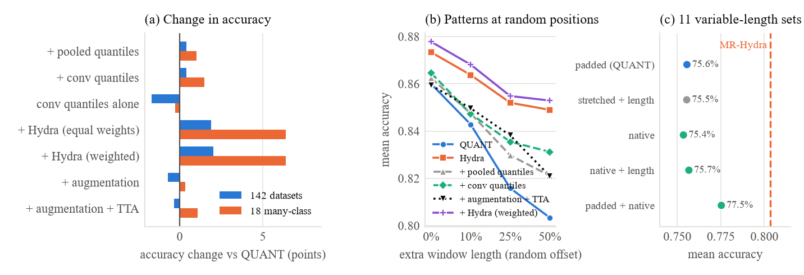

# Improving QUANT: what we tried and what happened

*Status, 7 October 2026: all experiments are complete: the five ideas, the stress test and the one-core timing.*

## The short version

We tried five ways to make QUANT more accurate. One clearly worked:

- **Combining QUANT with Hydra** (a second, very different method) raised average accuracy from **85.4% to 87.4%** over 142 datasets. That puts it level with HIVE-COTE 2, the most accurate method in the big 2024 comparison, which takes weeks.
- **The price:** on one CPU core, QUANT needs 16 minutes for all 142 datasets, and the combination needs **66 minutes** (simple average) to **91 minutes** (weighted average). That is **4–6× longer**. It is about what MultiRocket+Hydra costs, and that method is almost as accurate.

The other ideas:

- **Ideas 1 and 2** (new position-free features) helped a little: +0.4 points each.
- **Idea 10** (no padding) helped only in its second version, which keeps the padded view *and* adds the unpadded one: +2.0 points on the 11 variable-length datasets.
- **Idea 5** (augmentation) did not help on average.

When patterns were moved to random positions, every idea made QUANT more robust. The ensemble lost no more accuracy than Hydra, which ignores position entirely.

The main lesson is that QUANT's reliance on *where* things happen in a series is a weakness on some datasets and a strength on others. What works is *adding* a position-free view next to QUANT's own; replacing it does not work.

## Some words used below

- **Accuracy**: the share of test series a method labels correctly. "+1 point" means +1 percentage point, e.g. 85.4% → 86.4%.
- **Dataset**: one classification problem from the UCR archive, e.g. telling apart gestures, heartbeats or kinds of beef from their measured curves. We use the 142 datasets of the QUANT paper.
- **Resample**: one random split of a dataset into training and test data. The archive provides 30 fixed splits, so everyone tests on exactly the same splits.
- **W/D/L (wins/draws/losses)**: on how many datasets the new version beat, tied or lost to plain QUANT.
- **p-value (Wilcoxon signed-rank test)**: how likely a difference this consistent would be if the change really did nothing. Below 0.05 we call it a real effect, not luck.

## What the experiments were based on

1. **Our reproduction of QUANT.** We re-ran the paper's full experiment and got 85.51% vs the paper's 85.68%. The small gap comes from 4 datasets that were corrected after the paper was published. Plain QUANT's numbers below come from this run.
2. **Our weakness tests** (report Section V). These found where QUANT loses accuracy:
   - **When the same pattern appears at different times**, QUANT suffers. QUANT summarises fixed time windows (first half, second quarter, ...), so a pattern that moves lands in a different window. With patterns at random positions it lost 5.6 points, against 2.4 for Hydra.
   - **With many classes and few examples per class** it does badly: 5.6 points behind Hydra on 18 such datasets, and up to 27 points behind on the "Pig" heartbeat datasets.
   - **On variable-length series padded to equal length** (11 datasets), padding costs about 8 points on the most padded series.
3. **The ideas list** (`ideas.md`). We took the five highest-ranked ideas that run on a laptop CPU. Idea 4 (a pre-trained "TabPFN" classifier) was skipped because it needs a GPU.

**The test rules**, the same for every idea:

- **QUANT stays the same.** Its code is never changed. Each idea *adds* something: more features, extra training copies, or a second model. The classifier is always QUANT's own (a forest of 200 random trees, same settings).
- **Same data as the reproduction.** All 142 datasets use the same official splits and the same random seeds, so any difference comes from the idea itself. A built-in check confirms that plain QUANT gives exactly the reproduction's numbers in the new code.
- **10 splits per dataset instead of 30**, to fit the laptop (Ryzen 5 5600H, no GPU). The 11 variable-length datasets are small, so they got all 30. On the first 10 splits, plain QUANT scores **85.36%**, and that is the number to beat.
- **Code and output.** The code is `scripts/improvement_tests.py`, with the new features in `scripts/quant_extensions.py`. The numbers are produced by `scripts/improvement_analysis.py` and saved in `results/improvements/summary.txt`.

## The five ideas and their results

All accuracies are averages over 142 datasets × 10 splits unless noted. Plain QUANT scores 85.36%.

| Idea | What it adds | Accuracy | Change | W/D/L | p | Runtime vs QUANT** | Verdict |
|---|---|---|---|---|---|---|---|
| 3. QUANT + Hydra ensemble | a second method; average their votes | **87.39%** | **+2.03** | 99/10/33 | 4e-12 | **×5.8** (×4.2 with equal weights) | **Success** |
| 1. Position-free quantiles | "is this pattern *anywhere*?" features | 85.75% | +0.39 | 84/19/39 | 2e-6 | ×1.4 | Success (small) |
| 2. Quantiles of convolutions | small-shape detectors, summarised by quantiles | 85.76% | +0.40 | 78/7/57 | 0.004 | ×4.0 | Success (small) |
| 10. Variable-length QUANT: padded + native | keep the padded view, add windows that scale with each series | 77.53% vs 75.55%* | +1.97 | 10/0/1 | 0.005 | ×9† (our slow code; training ×1.9) | Success (on these 11) |
| 10a. ... native windows only | replace padding with windows that scale with each series | 75.66% vs 75.55%* | +0.11 | 5/0/6 | 0.9 | ×8† | Did not help |
| 5. Shift/stretch augmentation | shifted and stretched training copies | 84.64% | −0.72 | 46/9/87 | 7e-5 | ×5.8† | Did not help |
| 5b. ... + test-time averaging | the same, plus averaging over shifted test copies | 85.01% | −0.35 | 59/10/73 | 0.03 | ×5.9† | Did not help (but +1.1 on many-class data) |

\* Only the 11 variable-length datasets, with 30 splits.
\*\* Total time to compute the features, train and predict once on every dataset, on one CPU core, the way the QUANT paper reports its 15 minutes. Plain QUANT takes 15.7 minutes this way.
† Measured with all 12 threads instead (plain QUANT: 5.2 minutes), because these versions were not part of the one-core timing run.

### Idea 3: QUANT + Hydra ensemble. Success.

- **What we did:** trained QUANT and Hydra separately and averaged their predicted class probabilities. Hydra is a convolution method that counts which small shapes occur *anywhere* in a series.
  - Hydra's raw scores were first turned into probabilities, calibrated on the training data.
  - Each method's vote was weighted by how accurate it was in a cross-validation on the training data. This is the "CAWPE" rule from HIVE-COTE.
- **Why:** the two methods fail on different data. QUANT is good when *where* and *how high* the values are matters; Hydra is good when shapes move around.
- **Result:** 87.39%, **+2.0 points**, better on 99 datasets and worse on 33.
  - On the 18 many-class datasets: +6.4 points, e.g. PigCVP +27, PigAirwayPressure +26.
  - It beats picking the better of the two methods per dataset (87.29%), because combining helps even where both are decent.
  - Equal weights, without the extra cross-validation, gave almost the same: 87.25%, at a lower cost.
- **Cost: 4–6× slower than QUANT.** Compute time for one train/test run of all 142 datasets on one CPU core, measured the way the QUANT paper reports its 15 minutes:

  | | Minutes | vs QUANT | Accuracy |
  |---|---|---|---|
  | QUANT alone | 15.7 | ×1 | 85.36% |
  | QUANT + Hydra, equal weights | 65.6 | ×4.2 | 87.25% |
  | QUANT + Hydra, weighted | 91.3 | ×5.8 | 87.39% |

  - **Where the time goes** (weighted version, 91 min):
    - computing Hydra's features: 46 min, half of the total;
    - the extra cross-validation that sets the weights: 26 min;
    - QUANT itself: 16 min;
    - training Hydra's classifier: 4 min.
  - **The weighting is poor value.** It costs 26 extra minutes for +0.14 points, so the equal-weights version is the better deal.
  - **On all 12 threads** of the laptop, the same run takes 5.2 min (QUANT), 24.9 min (equal weights) and 34.1 min (weighted).
  - **In context:** the QUANT paper reports about an hour for MultiRocket+Hydra and several weeks for HIVE-COTE 2. So the ensemble reaches HIVE-COTE 2's accuracy at roughly MultiRocket+Hydra's cost. It is *not* cheaper than MultiRocket+Hydra, which is about as accurate.

### Idea 1: position-free pooled quantiles. Small success.

- **What we did:** slid windows of several sizes over the whole series and took quantiles in each. We then kept only the highest, lowest and average value of each quantile over all positions. These features say "somewhere there is a stretch like this", no matter where. QUANT's normal features were kept.
- **Result:** +0.4 points, better on 84 datasets and worse on 39. This is a small effect, but very unlikely to be luck (p = 0.000002).
  - The gain is larger where QUANT was weak: +1.0 on many-class data, and +10.8 on PigAirwayPressure.
  - **Cost:** it is cheap. It adds about 400 features, and the whole run takes 1.4× QUANT's time on one core (21.5 vs 15.7 min).

### Idea 2: quantiles of random convolutions ("QUANT meets ROCKET"). Small success.

- **What we did:** ran each series through 288 small fixed shape detectors (MiniRocket's kernels) and described each output by 9 quantiles over the whole series. These were added to QUANT's features.
- **Result:** +0.4 points (p = 0.004) and +1.5 on many-class data. That is the same overall gain as idea 1 for much more work: the whole run takes 4.0× QUANT's time on one core (62 vs 16 min). Most of that goes on computing the convolutions (40 min).
- **On their own,** these features were 1.7 points *worse* than QUANT. They only help as an addition.

### Idea 10: variable-length QUANT. Success, but only next to the padded version.

- **What we did:** for the 11 datasets whose series really have different lengths, we let each window cover the same *fraction* of every series (its first half, its second quarter, ...) instead of padding all series to one length. A sanity check confirmed that on equal-length data this gives exactly QUANT's features.
- **First version, replacing the padding:** no change on average (+0.1, p = 0.9), but big effects in both directions:
  - **Better:** GesturePebble +3.5 to +3.9, AllGestureWiimoteY +4.6, ShakeGesture +3.0.
  - **Worse:** GestureMidAir −3.6 to −6.7.
  - **Likely reason:** the padding tells the forest how long, and so how *fast*, a gesture was. On some datasets speed matters and on others it doesn't. Simply stretching all series to one length gave the same average (75.54%).
- **Second version, keeping both views** (padded features plus the native-window features, so the forest picks per dataset): **77.53% vs 75.55%, +2.0 points**.
  - Better on 10 of 11 datasets (p = 0.005).
  - It closes 41% of the gap to MultiRocket+Hydra on these datasets.
  - Across all 142 datasets this would move QUANT's average from 85.51% to 85.67%.
- **Caveat:** we added this version *after* seeing the first results, and tested it on the same 11 datasets. The gain is large and consistent, but it has not been confirmed on fresh data.
- **Cost:** in our code, the native windows take 117 s to compute for the 11 datasets, against 8 s for QUANT's features. That is because our simple implementation handles each distinct series length separately; a vectorised version should be much faster. Training takes 1.9× as long, because there are twice as many features.

### Idea 5: shift and stretch augmentation. Did not help on average.

- **What we did:**
  - **Training:** added four copies of every training series, shifted by ±10% and stretched by ±10%.
  - **Testing:** in a second version, also averaged the predictions over the same four copies of each test series ("test-time augmentation", TTA).
- **Result:** −0.7 points (−0.35 with TTA), worse on about twice as many datasets as it helped (87 vs 46). Both drops are small but real (p < 0.05). The first 28 datasets had suggested −2 points; all 142 show a smaller, mixed effect.
- **It helps where QUANT is weakest.** With TTA:
  - PigAirwayPressure +33 points, PigCVP +13;
  - +1.1 on the 18 many-class, few-example datasets.

  With only 2 examples per class, the forest cannot learn that a heartbeat may sit anywhere, and the shifted copies teach it that.
- **It hurts where position carries meaning:**
  - Beef −17 and CinCECGTorso −13. Beef is a set of light spectra, where the position along the series *is* the wavelength, so a shifted spectrum is a different spectrum.
  - Gesture data −2.3 points (PickupGestureWiimoteZ −6.6).
- **Cost:** the whole run takes about 6× as long, because the forest trains on 5× as much data.

## Stress test: patterns at random positions

This repeats our weakness test with each idea added. Every series is placed at a random offset inside a longer window, so the same pattern shows up at different times. There are 30 datasets and 5 splits each. "50%" means the window is 50% longer than the series.

| | No shift | 10% | 25% | 50% | Lost |
|---|---|---|---|---|---|
| QUANT | 86.0% | 84.3% | 81.6% | 80.3% | −5.7 |
| Hydra (reference, ignores position) | 87.3% | 86.4% | 85.2% | 84.9% | −2.4 |
| **QUANT + Hydra (idea 3)** | **87.8%** | **86.8%** | **85.5%** | **85.3%** | **−2.5** |
| QUANT + conv quantiles (idea 2) | 86.5% | 84.7% | 83.6% | 83.1% | −3.3 |
| QUANT + augmentation (idea 5) | 85.9% | 85.3% | 84.2% | 82.3% | −3.6 |
| QUANT + pooled quantiles (idea 1) | 86.3% | 84.8% | 83.0% | 82.1% | −4.1 |

- **Every idea makes QUANT more robust.** At 50%, each one beats plain QUANT on 21–26 of the 30 datasets (all p < 0.003). The gains are +5.0 points for the ensemble, +2.8 for the convolution features, +2.0 for augmentation and +1.8 for the pooled quantiles.
- **The ensemble is as robust as Hydra** (−2.5 vs −2.4) while staying more accurate than Hydra at every level.
- **Augmentation is the one idea that helps here but not on the normal benchmark.** Moved patterns are exactly what it trains for; on real data they are rarer than we assumed.

*(a) Accuracy change vs QUANT on all 142 datasets and on the 18 many-class datasets. (b) The stress test. (c) The 11 variable-length datasets.*

## How this compares with the original QUANT

| | Accuracy | Notes |
|---|---|---|
| QUANT, paper | 85.68% | 30 splits; uses 4 datasets that were later corrected. About 15 min on one core |
| QUANT, our reproduction | 85.51% (30 splits) / 85.36% (first 10) | the reference for this report. 15.7 min on one core of our laptop (18.3 min in an earlier timing run) |
| **QUANT + Hydra ensemble (ours)** | **87.39%** (first 10) | +2.0 points over QUANT. 91 min on one core (66 min with equal weights, at 87.25%) |
| MultiRocket+Hydra (2024 bake-off) | 87.06% (same 10 splits) | ours is +0.3 ahead, not significant (p = 0.37). About 1 h (QUANT paper) |
| HIVE-COTE 2 (2024 bake-off) | 87.53% (same 10 splits) | ours is −0.1 behind, not significant (p = 0.63). Several weeks (QUANT paper) |

The bake-off used the same official splits, so these comparisons are like-for-like. HIVE-COTE 2 combines several slow methods; our ensemble uses two fast ones.

## What we can conclude

1. **QUANT's habit of looking at fixed positions is not simply a flaw.** On spectra and many sensor datasets, *where* a value occurs carries the class.
   - **Forcing** QUANT to ignore position (augmentation) hurt on average. It only paid off on datasets with very few examples per class.
   - **Adding** a new view and letting the forest choose helped. That holds for the position-free features (ideas 1 and 2, a little almost everywhere) and for the unpadded windows (idea 10, +2 points, but only next to the padded view).
   - **A second, position-free model** (idea 3) helped most.
2. **The best fix is a second opinion, not a modified QUANT, but it has a price.** QUANT and Hydra make different mistakes, so averaging them gave a +2 point gain that no feature change came close to. It reaches top-method accuracy at 4–6× QUANT's runtime: 66–91 minutes on one core instead of 16. That is far cheaper than HIVE-COTE 2 (weeks), but about the same as MultiRocket+Hydra (about an hour), which is nearly as accurate. Plain QUANT is still the choice when speed matters most.
3. **The weakness tests predicted where gains would appear.** Every position-related idea, even augmentation, helped most on the many-class, few-example datasets that the weakness analysis flagged (+1 to +6 points there).
4. **Fancier features need to earn their cost.** The convolution features (idea 2, 4.0× the runtime) gave the same +0.4 as the much cheaper pooled quantiles (idea 1, 1.4×).
5. **Padding was not the problem we thought.** Removing it (idea 10) didn't help on average, which matches our weakness test: padding hurts QUANT and Hydra equally. The padding even carries useful information (the length, and so the speed, of a gesture). Giving the forest both views is what helped.
6. **Robustness and accuracy are different things.** Every idea made QUANT more robust to moved patterns. On real data, only the ones that keep QUANT's original view intact also improved accuracy.

## What is left

All experiments are done. The raw results are in `results/improvements/`; `python scripts/improvement_analysis.py` rebuilds `results/improvements/summary.txt` and the figure from them.

1. Write these results into Section VI of `Papers/documentation.tex`.
2. **Worth trying next:**
   - Do the gains stack? For example, QUANT + pooled quantiles inside the Hydra ensemble.
   - The equal-weights ensemble is nearly as good and cheaper, which makes it the practical choice.
   - Augmentation could be switched on only for datasets with very few examples per class.
   - Confirm idea 10's "padded + native" result on fresh data, e.g. the other splits (10–29), or variable-length datasets outside the 142.
